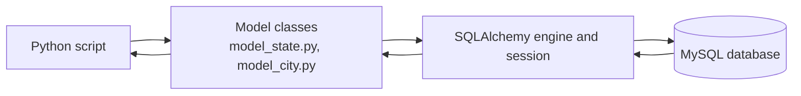
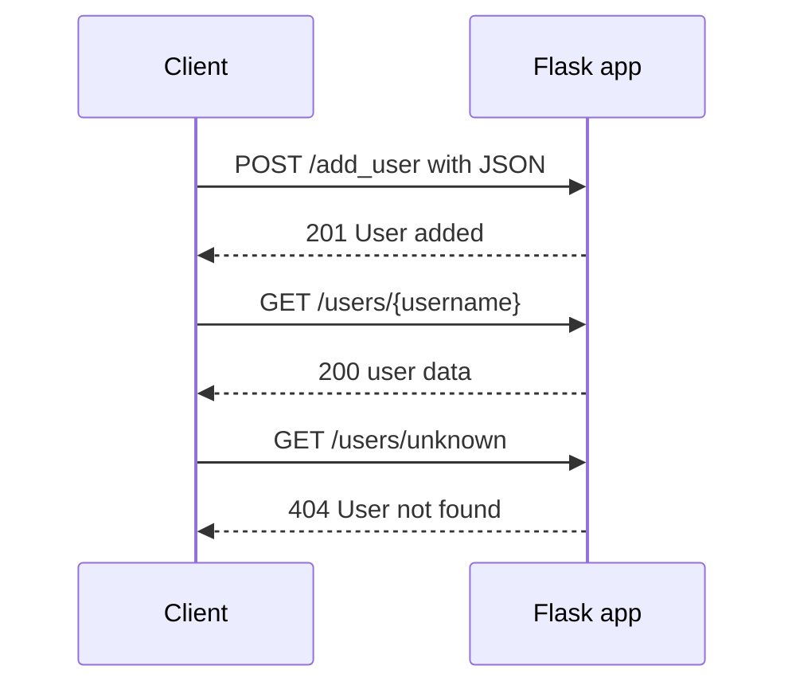

# Holberton School - Higher Level Programming

Python 3 projects from Holberton School about working with databases, saving data in different formats, and building APIs.

## Projects

| Folder | What is inside |
| --- | --- |
| [python-object_relational_mapping](python-object_relational_mapping/) | Python scripts that talk to a MySQL database, first with raw SQL, then with SQLAlchemy |
| [python-serialization](python-serialization/) | Saving and loading data: basic serialization, pickle, CSV and XML |
| [restful-api](restful-api/) | HTTP requests, a simple HTTP server, a Flask API and basic API security |

## python-object_relational_mapping

- Files `0` to `5` connect to MySQL and run queries (select, filter, and a safe version that avoids SQL injection).
- `model_state.py` and `model_city.py` define the classes linked to the database tables.
- Files `7` to `14` use SQLAlchemy to fetch, insert, update and delete rows without writing SQL by hand.



## python-serialization

| File | Format |
| --- | --- |
| `task_00_basic_serialization.py` | Basic serialization |
| `task_01_pickle.py` | Pickle |
| `task_02_csv.py` | CSV |
| `task_03_xml.py` | XML |

## restful-api

| File | Topic |
| --- | --- |
| `task_02_requests.py` | Getting data from an API with the `requests` library |
| `task_03_http_server.py` | A simple HTTP server |
| `task_04_flask.py` | An API built with Flask |
| `task_05_basic_security.py` | Basic API security |

The Flask API (`task_04_flask.py`) has these routes:

| Route | Method | What it does |
| --- | --- | --- |
| `/` | GET | Welcome message |
| `/data` | GET | List of all usernames |
| `/status` | GET | Returns `OK` |
| `/users/<username>` | GET | Data of one user, or `404` if not found |
| `/add_user` | POST | Add a user from JSON data |



When the request is wrong, `/add_user` returns `400` for invalid JSON or a missing username, and `409` if the username already exists.

## How to run

```bash
# Flask API
pip install flask
python3 restful-api/task_04_flask.py

# ORM scripts need MySQL and SQLAlchemy
pip install sqlalchemy mysqlclient
```

## Author

Arif Almusharafi - [GitHub](https://github.com/arif-almusharafi)
